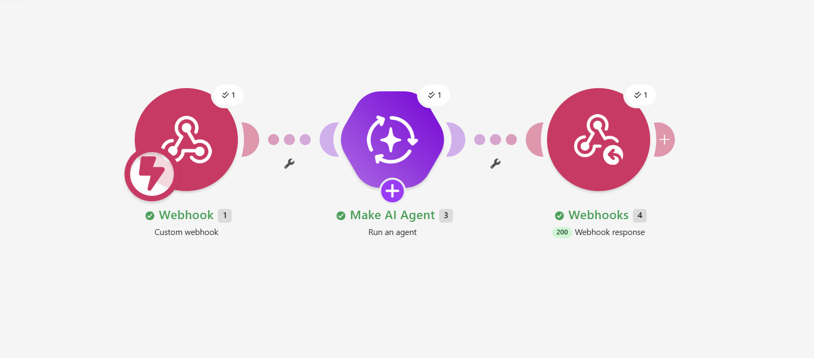

# Nombre del proyecto
Calculadora de huella ecológica

## Descripción
La página recopila diez respuestas sobre alimentación, transporte, energía, consumo y residuos. Las envía a un escenario de Make, donde un agente de IA estima la huella ecológica y propone acciones de reducción en el contexto de Mazatlán.

La estimación se muestra en hectáreas globales y planetas Tierra. El agente también ordena las áreas según su impacto y sugiere una oportunidad económica local.

## Objetivos de aprendizaje
- Identificar qué hábitos cotidianos pueden aumentar la huella ecológica.
- Diseñar un formulario web adaptable a computadora y celular.
- Integrar el formulario con un webhook, un agente de IA y una respuesta en Make.
- Interpretar una estimación de IA y reconocer sus límites.

## Material utilizado
- Computadora o celular con navegador y conexión a internet.
- HTML, CSS y JavaScript.
- Make con un webhook personalizado, Make AI Agent y Webhook response.
- GitHub para almacenar el código, la demostración y el informe.

## Diagrama del flujo
El formulario envía las diez respuestas mediante POST. Make recibe la solicitud, construye el mensaje del agente y devuelve el texto al navegador con una respuesta HTTP 200.

Formulario web → Webhook → Make AI Agent → Respuesta del webhook → Resultado en la página.

## Código
- [Calculadora web](c%C3%B3digo/index.html)
- [Blueprint del escenario de Make](c%C3%B3digo/Huella%20ecol%C3%B3gica.blueprint.json)

Para utilizar el proyecto:

1. Descarga el HTML e importa el blueprint en Make.
2. Crea tu webhook, selecciona una conexión para el agente y activa el escenario.
3. Coloca la URL HTTPS de tu webhook en `WEBHOOK_URL` dentro de tu copia privada del HTML.
4. Abre esa copia en el navegador, completa los diez campos y presiona **Calcular mi huella**. Si alojas la página, configura la respuesta de Make para permitir el origen de tu sitio.

La copia pública deja el webhook vacío y el blueprint deja sin vincular el webhook y la conexión de IA. El formulario incluye kilómetros diarios, pero el mensaje del blueprint todavía no pasa ese campo al agente.

## Video del funcionamiento

[Ver en YouTube](https://youtu.be/wDl3sm-_CGs) · [Video sin audio en el repositorio](video/Huella_ecologica_sin_audio.mp4)

## Imágenes
Integración de la calculadora con el agente de IA en Make:

## Conclusiones
La demostración muestra cómo se reciben las respuestas y cómo se presenta la estimación generada por Make. La salida de la IA sirve para discutir hábitos y acciones de mejora.

Para evaluar qué tan cerca queda la estimación de una calculadora de referencia, se necesitan resultados comparables del mismo perfil. El informe documenta el ejemplo del video y los datos que faltan para esa comparación.

## Resultados

[Reporte técnico y respuestas a las cinco preguntas (PDF)](resultados/Reporte_tecnico_huella_ecologica.pdf)
